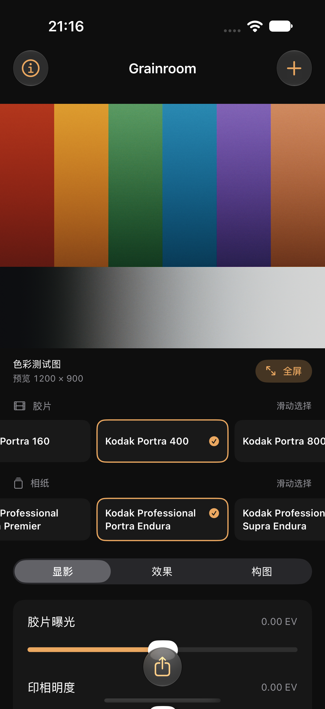
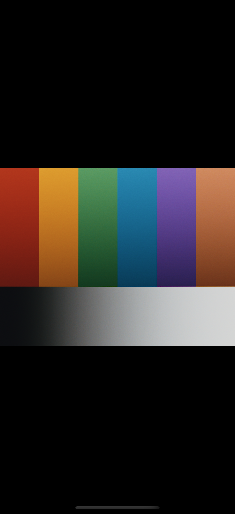

# Grainroom · iPhone 离线胶片编辑器

这是 [RayOnFire/SpektraLab](https://github.com/RayOnFire/SpektraLab) fork 中的非官方 iOS 移植，基于 [JamesQiu2005/SpektraLab](https://github.com/JamesQiu2005/SpektraLab) 的 C++/Metal 引擎及 Andrea Volpato 的 [spektrafilm](https://github.com/andreavolpato/spektrafilm)。Grainroom 使用独立产品名称和图标。

**本分支只发布源码，供使用者自行编译、签名和安装。** 不提供 App Store、TestFlight 或预签名安装包。源码保留完整上游历史、许可证和署名；这个发布方式没有为其他分发渠道添加许可例外。




## 首版功能

- 从系统照片选择器或“文件”导入一张照片，复制到应用沙盒，原始文件保留。
- 复用原有胶片/相纸配置、C++ 显影流程和 Metal 计算内核，包含彩色、黑白和反转片。
- 照片按原比例铺满可用宽度；胶片、相纸在主界面横向平铺，直接点选，当前项高亮。
- 轻点照片或“全屏”收起编辑区域；全屏支持双指缩放、放大后拖动和双击放大/复位。轻点画面显示退出按钮。
- 编辑和全屏界面都可长按照片暂看原图，松手恢复胶片效果，缩放和位置保持一致。
- 胶片曝光、印相明度、颗粒、光晕；Core Image 支持的 RAW 提供相机/自定义白平衡。
- 原图对比、居中比例裁剪、90° 旋转和镜像。原图预览与显影使用相同构图。
- 导出 JPEG 或 PNG，保存到照片或通过系统分享保存到文件。
- 本地保存最近一张照片及调整，退出后可恢复；无需账号或网络服务。

这是单张编辑器，未移植桌面版的图库、批处理、CLI/MCP、日期背、胶片边框和半格拼接。

## 自行编译

需要 Mac、支持 Swift 6 的 Xcode 及其 iOS SDK/Metal 编译器组件。已验证环境为 **Xcode 27.1、iOS 27.0 模拟器**；工程部署目标为 **iOS 17.0**，尚未在 iOS 17 真机验证。无需 Python 图像处理环境、第三方包下载或服务端。

```sh
git clone --branch ios/grainroom-source-port https://github.com/RayOnFire/SpektraLab.git
cd SpektraLab
open ios/Grainroom.xcodeproj
```

在 Xcode 中选择 `Grainroom` scheme：

1. 模拟器：选择 iPhone 模拟器后运行。
2. 自己的 iPhone：在 Grainroom target 的 Signing & Capabilities 中选择自己的 Team，将 Bundle Identifier 改为自己的唯一标识，再选择连接的设备运行。源码不附带作者的签名、证书或设备配置。
3. 首次启动可点“打开色彩测试图”，不必授权读取整个照片图库。导入使用系统选择器，保存到照片时才请求添加照片权限。

若 Xcode 提示缺少 Metal 编译器，在 Xcode 的组件设置中安装对应组件。构建脚本使用 SDK 自带的 `metal`/`metallib`，保留上游的 safe/precise 数学模式，不要打开 fast math。

命令行验证（将设备名称改为本机存在的模拟器）：

```sh
xcodebuild -project ios/Grainroom.xcodeproj -scheme Grainroom \
  -destination 'platform=iOS Simulator,name=iPhone 18 Pro' \
  -derivedDataPath ios/build CODE_SIGNING_ALLOWED=NO test

xcodebuild -project ios/Grainroom.xcodeproj -scheme Grainroom \
  -configuration Release -destination 'generic/platform=iOS' \
  -derivedDataPath ios/build/device CODE_SIGNING_ALLOWED=NO build
```

第二条只检查设备架构编译与链接，不能把未签名产物直接装到 iPhone。普通使用者无需重新生成工程；增删源码文件后运行 `python3 ios/Tools/gen-project.py`，检查确定性使用 `--check`。生成器复用桌面工程的 PBX 工具和引擎源码列表，不复制一套引擎。

照片保存 UI 测试会向模拟器图库写入自带色彩测试图，请使用专用模拟器。测试会处理添加照片的授权提示；如果恢复的是自己的照片，保存测试会提前失败，避免把它作为测试输入。

## 尺寸、颜色与设备限制

预览最长边 1600 像素，在生成引擎输入前限制解码尺寸。导出可选最长边 1600、2560、4096，另受 1200 万像素上限约束，不放大原图。输出带 sRGB 色彩描述；JPEG 为有损、PNG 为 16 位。源 EXIF 继续附在导出中，不复制 GPS 字典。

没有空闲时自动全分辨率显影。导出结束和应用进入后台时释放引擎缓存；渲染按串行 actor 执行，快速调整只展示最后一次有效结果。每次 GPU 运算并不能即时取消，较小尺寸更适合较老设备。

内存准入检查采用保守估算，**不等于已经测得的真机内存预算**。真机峰值内存、发热、4096 像素导出、相机 RAW/Apple ProRAW 和照片权限流程仍需设备测试。Core Image 能否解码具体 RAW 取决于系统支持；不支持的文件会显示错误。iPad 可构建，但首版布局与交互优先 iPhone。

自动化检查包含真实模拟器内的 Metal 显影、参数更新、彩色/黑白/反转片切换、HEIC 及旋转方向、JPEG/PNG 写入后重新解码、尺寸限制、构图一致性和许可证资源。看图模式另有 UIKit 缩放、对比取消和位置一致性检查，以及实际双指/长按操作的 XCUITest。详细结果与上游回归测试的跳过项见 [WORK_STATE.md](WORK_STATE.md)。

看图模式使用当前预览缓存，缩放和原图对比不会触发新的显影。画面始终保留照片比例；横向照片全屏时可旋转 iPhone 横向查看。缩放显示当前预览的细节，不会自动改为全分辨率解码。

## 许可证与来源

- 应用及引擎代码：根目录 [LICENSE.txt](../LICENSE.txt)，**GPL-3.0-or-later**。移植修改同样采用该许可证，见 [MODIFICATIONS.md](MODIFICATIONS.md)。
- spektrafilm 的配置和派生 LUT：**CC BY-SA 4.0**，作者 Andrea Volpato；保留 [SPEKTRAFILM_LICENSE.txt](../license/SPEKTRAFILM_LICENSE.txt) 及随附数据改动记录。
- SpektraLab 额外黑白配置及来源见 [engine/resources_product/NOTICE.md](../engine/resources_product/NOTICE.md)，原始资源数组与计算内核未因移植修改。
- metal-cpp：Apache 2.0，保留其许可证。

完整许可证、数据改动记录和产品数据说明随编译后的应用提供，可从“关于与许可证”查看。上游软件及胶片厂商名称仅用于来源和材料标识，本项目没有官方关联。
